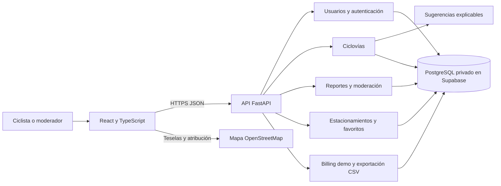

# Arquitectura de CicloLima

El sistema sigue el monolito modular de Ayni, adaptado al caso de ciclistas. Un despliegue de la API reduce la complejidad operativa; cada módulo separa transporte, validación, negocio y persistencia.

## Capas

| Capa | Ubicación | Responsabilidad |
|---|---|---|
| Presentación | frontend/src | Mapa, filtros, formularios y estados |
| Transporte | modules/*/router.py | Endpoints y permisos |
| Contratos | modules/*/schemas.py | Validación y serialización |
| Negocio | modules/*/service.py | Casos de uso y reglas |
| Persistencia | modules/*/repository.py | Consultas y escrituras |
| Datos | modules/*/models.py | Tablas y restricciones |

Un módulo consume la interfaz pública service.py de otro módulo. Las credenciales privilegiadas permanecen en el servidor. JWT con vencimiento autentica las peticiones; el rol se consulta en la base de datos, no se acepta del cliente. El cierre de sesión invalida las sesiones del usuario mediante una versión persistida.

SQLite permite desarrollo local sin servicios externos; PostgreSQL es obligatorio en producción y se usa también en integración CI. Alembic aplica las migraciones; el arranque de la aplicación no crea tablas automáticamente.

## Decisiones del caso

- Consultar tramos no implica calcular una ruta segura entre origen y destino.
- Los reportes entran pendientes; solo un moderador puede publicarlos o rechazarlos.
- Las condiciones mostradas son reportadas, no certificaciones de seguridad.
- Los datos iniciales son sintéticos y llevan identificación de demostración.
- La API no registra ubicación continua ni necesita permisos de geolocalización.

## Diagramas editables y despliegue

`docs/diagrams/Arquitectura_CicloLima.drawio` contiene arquitectura lógica y despliegue, con logos pequeños. Las capturas originales abiertas en diagrams.net están en `docs/evidence/`. React consulta teselas de OpenStreetMap desde el navegador y la API mediante HTTPS; el servidor accede al esquema privado de Supabase mediante SQL y TLS. Los servicios estáticos y API de Render, y las bases de Supabase, son independientes por ambiente.

La autenticación es propia de FastAPI con JWT y Argon2. Supabase se utiliza como PostgreSQL gestionado. El módulo billing almacena planes y comprobantes simulados y exporta los favoritos de su propietario; no integra una pasarela de pagos. Las sugerencias pertenecen al módulo ciclovías y comparan distancia e incidencias publicadas mediante reglas explicables.

GitHub Actions valida PRs a main con build, tests y seguridad. Después del merge despliega el SHA a stage; producción requiere aprobar la promoción de ese mismo SHA. Render ofrece logs y health checks; el pipeline comprueba `/ready` y `/version.json`.

## Justificación del stack

React y Leaflet sincronizan mapa, filtros y lista para el ciclista. FastAPI valida reportes y aplica permisos en una API documentada. SQLAlchemy y PostgreSQL mantienen relaciones y restricciones entre usuarios, reportes, favoritos y planes. Alembic permite reproducir el esquema sin crear tablas implícitamente al atender peticiones. Render y Supabase reducen los componentes operativos del MVP y permiten aislar los ambientes. GitHub Actions reúne pruebas y seguridad antes del despliegue; Jira vincula capacidades, aceptación y evidencia de la simulación.

## Referencias técnicas

- [FastAPI y JWT](https://fastapi.tiangolo.com/tutorial/security/oauth2-jwt/)
- [Leaflet estable](https://leafletjs.com/reference-1.9.4.html)
- [Vite](https://vite.dev/guide/)
