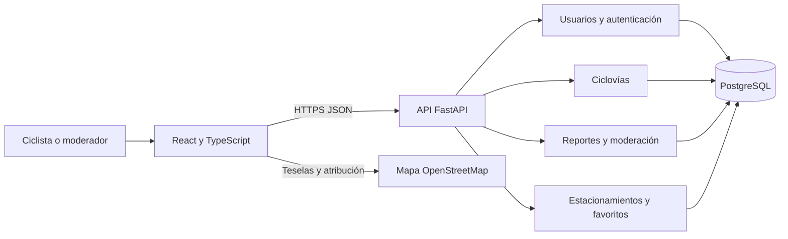

# Arquitectura de CicloLima

El sistema sigue el monolito modular de Ayni, adaptado al caso de ciclistas. Un despliegue de la API reduce la complejidad operativa; cada módulo separa transporte, validación, negocio y persistencia.

## Capas

| Capa | Ubicación | Responsabilidad |
|---|---|---|
| Presentación | frontend/src | Mapa, filtros, formularios y estados |
| Transporte | modules/*/router.py | Endpoints y permisos |
| Contratos | modules/*/schemas.py | Validación y serialización |
| Negocio | modules/*/service.py | Casos de uso y reglas |
| Persistencia | modules/*/repository.py | Consultas y escrituras |
| Datos | modules/*/models.py | Tablas y restricciones |

Un módulo consume la interfaz pública service.py de otro módulo. Las credenciales privilegiadas permanecen en el servidor. JWT con vencimiento autentica las peticiones; el rol se consulta en la base de datos, no se acepta del cliente. El cierre de sesión invalida las sesiones del usuario mediante una versión persistida.

SQLite permite desarrollo local sin servicios externos; PostgreSQL es obligatorio en producción y se usa también en integración CI. Alembic aplica las migraciones; el arranque de la aplicación no crea tablas automáticamente.

## Decisiones del caso

- Consultar tramos no implica calcular una ruta segura entre origen y destino.
- Los reportes entran pendientes; solo un moderador puede publicarlos o rechazarlos.
- Las condiciones mostradas son reportadas, no certificaciones de seguridad.
- Los datos iniciales son sintéticos y llevan identificación de demostración.
- La API no registra ubicación continua ni necesita permisos de geolocalización.

## Referencias técnicas

- [FastAPI y JWT](https://fastapi.tiangolo.com/tutorial/security/oauth2-jwt/)
- [Leaflet estable](https://leafletjs.com/reference-1.9.4.html)
- [Vite](https://vite.dev/guide/)
