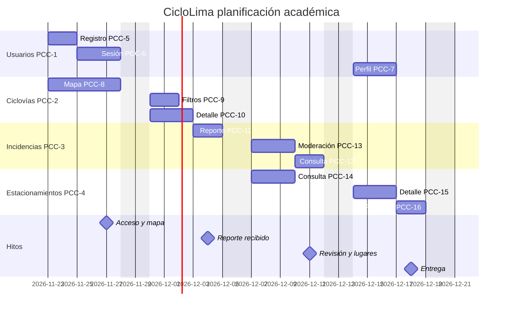

# Backlog y cuatro sprints

El proyecto [PCC](https://josephchombo.atlassian.net/jira/software/projects/PCC/boards/34/backlog) contiene cuatro épicas y doce historias. La estimación inicial individual usa Fibonacci; las prioridades MoSCoW también figuran como etiquetas. Cada historia contiene criterios Dado/Cuando/Entonces, fechas y sprint.

| Épica | Historias | Puntos |
|---|---|---|
| PCC-1 Usuarios y acceso | PCC-5 registro, PCC-6 sesión, PCC-7 perfil | 13 |
| PCC-2 Consulta de ciclovías | PCC-8 mapa, PCC-9 filtros, PCC-10 detalle | 13 |
| PCC-3 Incidencias ciudadanas | PCC-11 reporte, PCC-12 consulta, PCC-13 moderación | 13 |
| PCC-4 Estacionamientos | PCC-14 consulta, PCC-15 detalle, PCC-16 favoritos | 13 |

| Sprint | Fechas de planificación | Objetivo | Historias | SP |
|---|---|---|---|---|
| 1 | 23–27 noviembre 2026 | Registro, sesión y mapa | PCC-5, PCC-6, PCC-8 | 13 |
| 2 | 30 noviembre–4 diciembre | Filtros, detalle y aporte | PCC-9, PCC-10, PCC-11 | 13 |
| 3 | 7–11 diciembre | Moderación y estacionamientos | PCC-12, PCC-13, PCC-14 | 13 |
| 4 | 14–18 diciembre | Preferencias y favoritos | PCC-7, PCC-15, PCC-16 | 13 |

El calendario describe la simulación académica planificada; no acredita cuatro semanas de ejecución. El tablero se configuró con To Do, In Progress, In Review y Done. In Progress e In Review tienen límite WIP 1. Las historias no se marcan Done solo por existir el código.

## Criterio de terminado

Aceptación comprobada; pruebas aprobadas; PR revisado; controles de seguridad satisfactorios; comprobación en el ambiente de pruebas y evidencia enlazada. Para trabajo individual se identifica la autorrevisión.

## Simulación reproducible

Los gráficos de `docs/figures/` se generan con `scripts/generate_planning_figures.py`. Sus series son un escenario académico explícito de cierre de historias, no una exportación del historial de Jira. Cada sprint parte de tres historias y trece puntos; solo se descuentan al aceptarse. La velocidad del escenario es 13 puntos por sprint. No se declara como velocidad real del proyecto.

Al ejecutar los sprints en Jira, conservar capturas de inicio, avance y cierre y comparar el escenario con el historial real. No retroceder fechas ni inventar transiciones para obtener un burndown.

## Gantt y dependencias

Además de las flechas temporales, reportar requiere sesión y mapa; moderar requiere reporte; consultar reportes depende de su publicación; favoritos requiere sesión y estacionamiento. Estas dependencias deben conservarse al ajustar el calendario de entrega.
