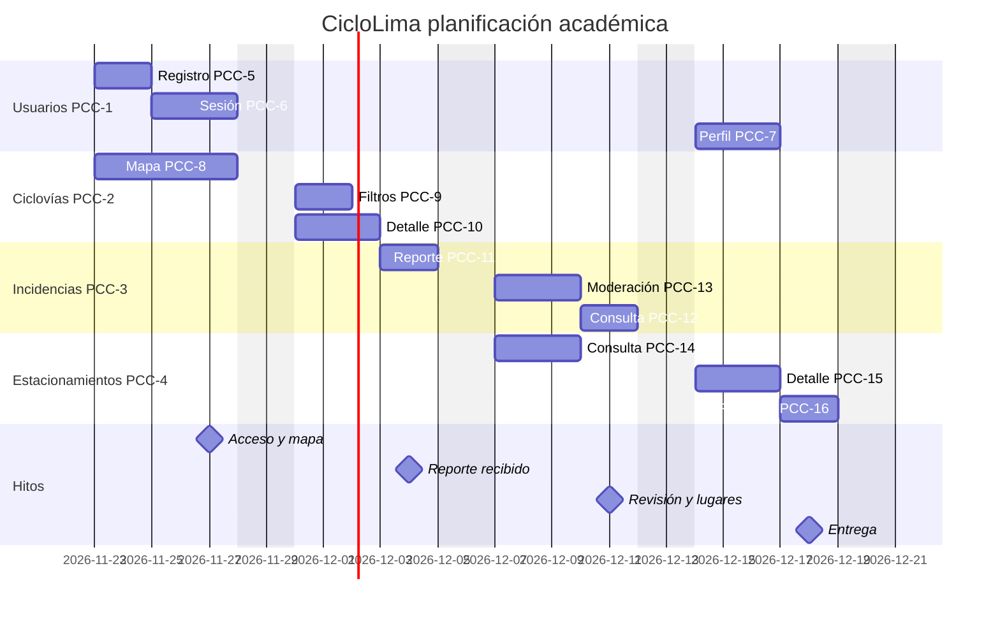

# Backlog y cuatro sprints

El proyecto [PCC](https://josephchombo.atlassian.net/jira/software/projects/PCC/boards/34/backlog) contiene cuatro épicas, 16 historias y cuatro hitos sin puntos. La base original suma 52 SP; las cuatro mejoras agregan 7 SP: 59 SP de alcance total. Las prioridades MoSCoW figuran como etiquetas. Cada historia contiene Como/quiero/para, criterios Dado/Cuando/Entonces, fechas y sprint.

| Épica | Historias | Puntos |
|---|---|---|
| PCC-1 Usuarios y acceso | PCC-5 registro, PCC-6 sesión, PCC-7 perfil, PCC-18 footer, PCC-20 billing | 17 |
| PCC-2 Consulta de ciclovías | PCC-8 mapa, PCC-9 filtros, PCC-10 detalle, PCC-17 catálogo, PCC-19 sugerencias | 16 |
| PCC-3 Incidencias ciudadanas | PCC-11 reporte, PCC-12 consulta, PCC-13 moderación | 13 |
| PCC-4 Estacionamientos | PCC-14 consulta, PCC-15 detalle, PCC-16 favoritos | 13 |

| Sprint | Fechas de planificación | Objetivo | Historias | SP |
|---|---|---|---|---|
| 1 | 23–27 noviembre 2026 | Registro, sesión y mapa | PCC-5, PCC-6, PCC-8 | 13 |
| 2 | 30 noviembre–4 diciembre | Filtros, detalle y aporte | PCC-9, PCC-10, PCC-11 | 13 |
| 3 | 7–11 diciembre | Moderación y estacionamientos | PCC-12, PCC-13, PCC-14 | 13 |
| 4 | 14–18 diciembre | Preferencias y favoritos | PCC-7, PCC-15, PCC-16 | 13 |

El calendario describe la simulación académica planificada; no acredita cuatro semanas de ejecución. El tablero se configuró con To Do, In Progress, In Review y Done. In Progress e In Review tienen límite WIP 1. Las historias no se marcan Done solo por existir el código.

## Criterio de terminado

Aceptación comprobada; pruebas aprobadas; PR revisado; controles de seguridad satisfactorios; comprobación en el ambiente de pruebas y evidencia enlazada. Para trabajo individual se identifica la autorrevisión.

## Ejecución y replanificación

Las fechas de la tabla anterior son el calendario propuesto del Gantt. En Jira las ventanas de ejecución se comprimieron a una hora. Los tres primeros sprints se completaron rápidamente sobre el MVP ya implementado; sus curvas conservan esos cierres concentrados. La reapertura para corregir sus ventanas modificó la fecha administrativa de cierre, conservando las transiciones originales.

El sprint 4 incorporó mejoras: PCC-17 catálogo (1 SP), PCC-18 footer (1 SP), PCC-19 sugerencias (2 SP), PCC-20 billing demo (3 SP). Tras definir ese alcance y estimaciones, su línea base se replanificó a 7 SP. Ventana actual: 19/11/2026 23:09–20/11/2026 00:09, America/Lima. Los cierres reales de las cuatro mejoras generan 7 → 6 → 5 → 3 → 0. No se borraron ni retrocedieron transiciones. Esta replanificación no debe presentarse como la planificación original.

PCC-7, PCC-15 y PCC-16 ya estaban Done antes de esa ventana: Jira los muestra como completados fuera del sprint. Sus 13 SP no se cuentan otra vez en la velocidad actual. El sprint 4 se cerró el 20/11/2026 a las 00:40 (America/Lima), tras capturar sus tarjetas y límites WIP. Su cierre administrativo fue posterior al final planificado de las 00:09; todas las mejoras estaban Done desde las 23:49 del día anterior.

| Sprint | Estado | SP aceptados en su ventana actual |
|---|---|---|
| 1 | Cerrado | 13 |
| 2 | Cerrado | 13 |
| 3 | Cerrado | 13 |
| 4 | Cerrado | 7 |

La exportación [jira-execution.json](evidence/jira-execution.json) contiene ventanas, estados, puntos, dependencias e historial, sin credenciales ni identificadores de cuenta. `scripts/generate_execution_figures.py` genera burndowns de historias ideal/observado y velocidad a partir de ella. Excluye historias ya Done al inicio y conserva los tiempos reales. No reparte cierres artificialmente.

## Escenario de planificación original

Los gráficos de `docs/figures/` se generan con `scripts/generate_planning_figures.py`. Sus series son un escenario académico explícito de cierre de historias, no una exportación del historial de Jira. Cada sprint parte de tres historias y trece puntos; solo se descuentan al aceptarse. La velocidad del escenario es 13 puntos por sprint. No se declara como velocidad real del proyecto.

Los gráficos observados y las capturas nativas de Jira son la evidencia de ejecución. Los escenarios hipotéticos anteriores no deben usarse como prueba de trabajo real.

## Gantt y dependencias

En Timeline de Jira, usar Weeks, expandir las épicas, activar Dependencies y alinear las barras con **Work item start/end dates**. Alinear por sprints comprime las barras en un día. Las historias tienen inicio/vencimiento y enlaces Blocks: registro → sesión → perfil; mapa → filtros/detalle; sesión y detalle → reporte → moderación → consulta; sesión y estacionamientos → favoritos; catálogo → sugerencias; sesión y favoritos → billing.

Las mejoras PCC-17/18/19/20 están planificadas para 30/11–01/12, 18/12, 14–16/12 y 17–18/12 respectivamente. Son fechas propuestas, no fechas de ejecución real. Los hitos PCC-21/22/23/24 corresponden a 27/11, 04/12, 11/12 y 18/12; son tareas sin SP ni sprint para no añadir alcance al burndown. H4 exige verificar el MVP ampliado en producción.
